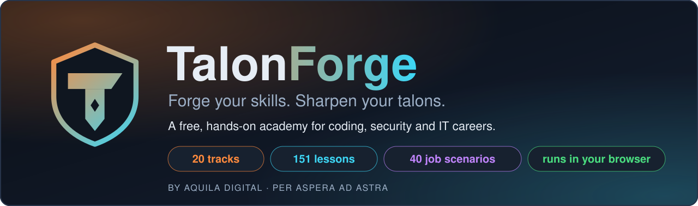
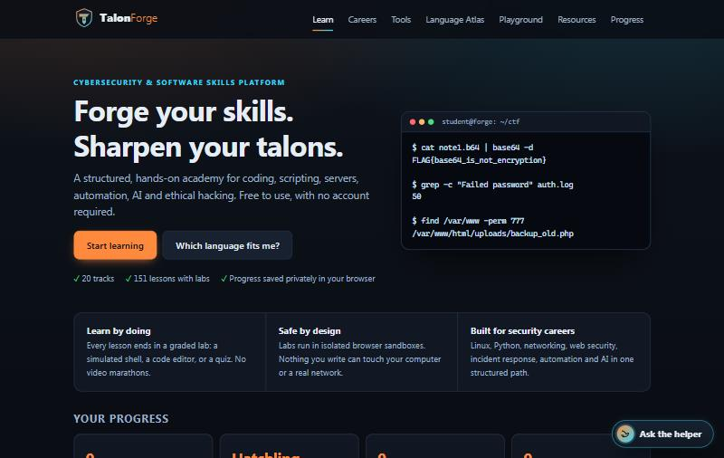
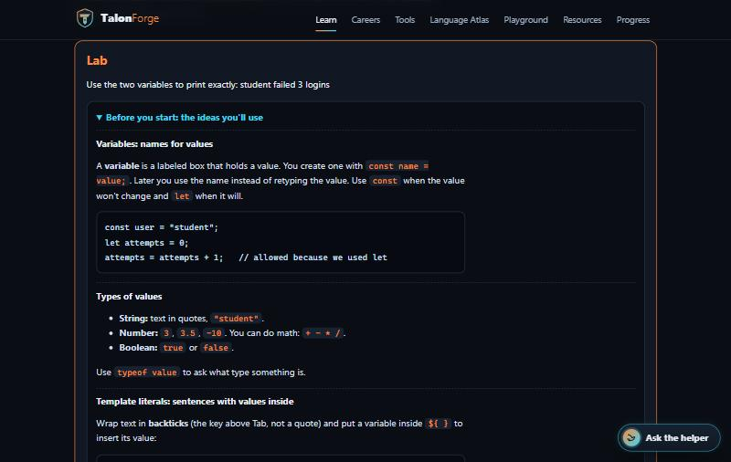
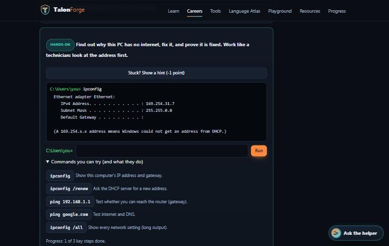
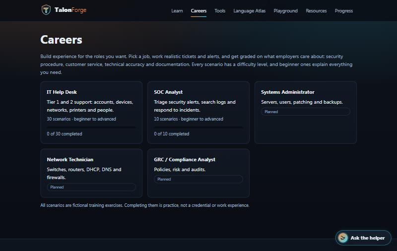
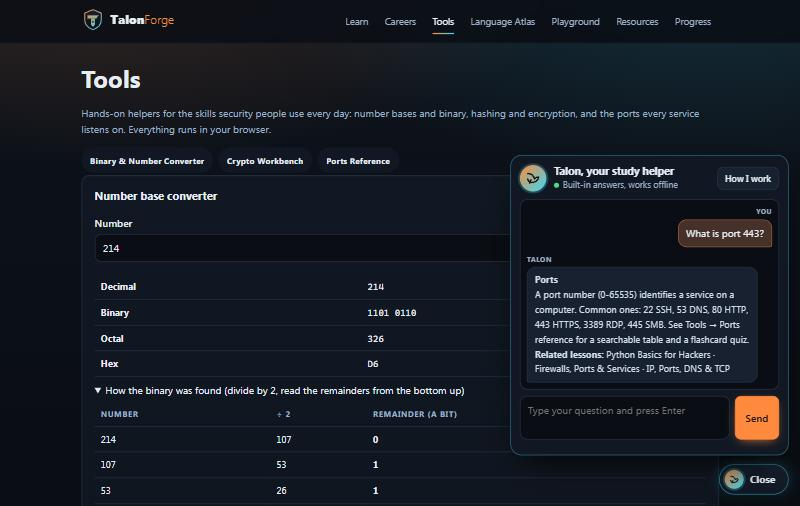
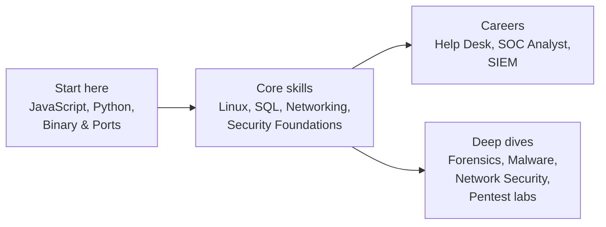

<div align="center">



<br>


**[Aquila Digital](https://www.aquiladigital.net/)** · *Per Aspera Ad Astra*

</div>

---

## What is TalonForge?

TalonForge is a **free, hands-on learning platform** for people who want to code, work in security, or land an IT job, and who want to *do* the work instead of watching videos. Every lesson ends in a lab that runs safely in your browser. There is no account to create and nothing to install.

It is written for **complete beginners**. Each lab explains the ideas it uses, gives a numbered plan, links the lessons to read first, and translates error messages into plain English.

<p align="center">
  
</p>

## Highlights

| | |
| --- | --- |
| **20 tracks, 151 lessons** | From "your first program" to malware analysis, digital forensics and network security |
| **Labs that run in your browser** | Simulated Linux shell, Python (WebAssembly), JavaScript (sandboxed worker), real SQL, a SIEM search console and quizzes |
| **Job simulators** | Practice **IT help desk** and **SOC analyst** work: tickets, alerts, log searches, containment and write-ups. 40 scenarios at beginner, intermediate and advanced levels, 11 of them fully hands-on |
| **Tools** | Number-base converter, crypto workbench (hashing, ciphers, AES-GCM) and a ports reference with flashcards |
| **"Talon" the study helper** | Ask about a word or an error. Works offline; optional AI answers if the site owner enables them |
| **Private by default** | No accounts, no analytics, no cookies. Progress lives in your own browser |
| **White-label ready** | One brand file re-skins the name, colors, ranks and footer |

## See it in action

<table>
  <tr>
    <td width="50%"><br><sub><b>Labs that teach first.</b> Concepts, a plan and hints before you write a line.</sub></td>
    <td width="50%"><br><sub><b>Hands-on job practice.</b> Run real commands in a simulated help desk terminal.</sub></td>
  </tr>
  <tr>
    <td width="50%"><br><sub><b>Careers.</b> Pick a role, work realistic tickets and alerts, get scored.</sub></td>
    <td width="50%"><br><sub><b>Talon, the study helper.</b> Plain-English answers, no sign-up.</sub></td>
  </tr>
</table>

## Learning path



Each track page shows a **"Do these first"** box so subjects build on each other.

### The 20 tracks

| Stage | Tracks |
| --- | --- |
| **Start here** (no experience needed) | JavaScript Foundations · Python Foundations · Binary, Encryption, Hashing & Ports |
| **Careers and foundations** | SIEM & SOC Analyst · Networking Essentials · Security Foundations |
| **Core skills** | Linux & the Shell · Databases & SQL · Python for Security · Web & JavaScript · Automation & Scripting · Building AI · Math for Security |
| **Security deep dives** | Ethical Hacking · Kali Pentest Lab (simulated) · Cyber Range Labs · Digital Forensics · Malware Analytics · Network Security · Systems & Servers |

## Job simulators

| Role | Scenarios | Examples |
| --- | --- | --- |
| **IT Help Desk** | 30 | Password reset with identity verification, "no internet" troubleshooting with real commands, lost laptop, ransomware note, same-day offboarding, prioritizing a queue |
| **SOC Analyst** | 10 | Brute-force then success, DNS beaconing, large outbound transfer, phishing report, impossible-travel sign-in |
| *Sysadmin, Network Technician, GRC* | *planned* | |

Scenarios are graded on **security procedure, customer service, technical accuracy and documentation**. Beginner scenarios explain every term and offer hints; advanced ones don't. Everything is fictional, and completing a scenario is practice, **not** a credential or work experience.

## Quick start

```bash
git clone https://github.com/Steven6Brown/TalonForge-Coding-Education-Platform.git
cd TalonForge-Coding-Education-Platform
npm install
npm run dev          # http://localhost:3000
```

```bash
npm test             # 185 tests
npm run typecheck
npm run lint
npm run build && npm start
```

Requires Node 20+. Accounts and AI answers are **off by default**; no environment variables are needed to run. See [`.env.example`](.env.example) for the optional ones.

## How it is built

- **Next.js 15 (App Router) + React 19 + TypeScript.** Lessons are Markdown files rendered by a small safe renderer (never raw HTML).
- **Labs run in the browser.** JavaScript in a Web Worker with its own CSP (no network), Python via Pyodide, SQL via sql.js, and the shell, help desk terminals and SIEM are in-memory simulators. No learner code reaches a server.
- **Local-first.** Progress is stored in the browser and can be exported and imported.
- **Optional services, switched off:** Supabase accounts (MFA, recovery codes, roles) and an AI helper route. Both are feature-flagged.

```
content/lessons/        Lesson text (Markdown)
src/lib/content/        Tracks, lessons, labs, beginner scaffolds, track paths
src/lib/shell/          Virtual filesystem and shell simulator
src/lib/siem/           Search engine and fictional log data
src/lib/sim/            Career scenarios and hands-on tasks
src/components/         UI (labs, careers, tools, helper)
src/brands/             White-label brand configs
docs/                   Guides (authoring, deploy, architecture, testing, privacy, auth)
```

## Documentation

| Doc | What it covers |
| --- | --- |
| [Authoring guide](docs/CONTENT.md) | How to add lessons, labs, scenarios and hands-on tasks |
| [Architecture](docs/ARCHITECTURE.md) | Decisions, layers, what is deferred |
| [Security model](SECURITY.md) | Sandboxing, hardening, known limitations |
| [Privacy](docs/PRIVACY.md) | What is stored, what is sent, and when |
| [Testing and status](docs/TESTING.md) | What is verified and, just as important, what is **not** |
| [Deploying to Vercel](docs/DEPLOY.md) | First-deploy checklist |
| [Accounts (Supabase)](docs/AUTH.md) | Auth feature map and setup |
| [Changelog](CHANGELOG.md) | What changed and when |

## Project status

TalonForge is **pre-launch**. It has not been deployed yet, and some things are deliberately unverified: the optional AI route against the live API, the accounts flow against a live Supabase project, mobile and screen-reader audits, and testing with real beginners. [docs/TESTING.md](docs/TESTING.md) lists them honestly.

**Roadmap:** more advanced scenarios, Sysadmin / Network Technician / GRC roles, an "experience log" you can share, self-hosted Python and SQL engines, and nonce-based CSP.

## White-labeling

Copy `src/brands/talonforge.ts`, change the name, colors and ranks, register it in `src/brands/index.ts`, and build with `NEXT_PUBLIC_BRAND=<id>`. One deployment per tenant for now.

## Responsible use

For education only. Practice security techniques solely on systems you own or have written permission to test. The labs and scenarios here are simulations and fictional.

## About

Built by **[Aquila Digital](https://www.aquiladigital.net/)** as a portfolio project. The code is published for **viewing**; see [LICENSE](LICENSE) (all rights reserved, no reuse without permission). The name "TalonForge" has not had a trademark or domain search.
